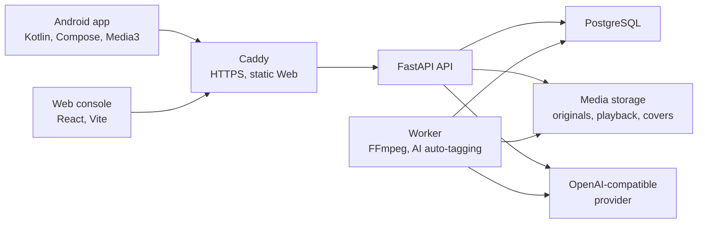

# Easy Music Architecture

How the system works now. Field-level detail lives in the code
(`backend/app/models/`, `backend/app/schemas/`) and the OpenAPI UI at `/docs`;
this document records the shape of the system and the rules the code must
keep.

## Components

- The API and the worker share one codebase (`backend/`), one database, and
  the media volumes. The API creates `processing_jobs`; the worker polls and
  runs them. They never call each other directly.
- Production runs all services with Docker Compose on one Ubuntu host. Caddy
  terminates HTTPS and serves the built Web app. Containers run as UID/GID
  1100. Host paths and procedures are in [DEPLOYMENT.md](DEPLOYMENT.md).
- The system is single-user, but every owned table carries `user_id` and every
  query is scoped by it.

## Backend

Python 3.12, FastAPI, SQLAlchemy, Alembic, PostgreSQL, FFmpeg/ffprobe.

- `api/routes/` are thin: authenticate, validate a schema, call a service.
- `services/` hold the business logic: uploads, video uploads, imports,
  processing, tracks, tags, playlists, playback and feedback events,
  recommendations, revived tracks, duplicates, library reports, and AI
  (provider, intent parsing, tag suggestions, tag search, auto-tagging,
  metadata clean-up).
- `media/` owns storage paths, path-safety checks, filename title clean-up,
  FFmpeg and ffprobe wrappers, and streaming responses.
- `worker/` runs the job loop and the `renormalize` and `autotag` backfills.

### Data Model

| Table | Holds | Rules |
| --- | --- | --- |
| `users` | The owner account. | Created once by `app.auth.initial_user`. |
| `refresh_tokens` | SHA-256 hashes of refresh tokens. | Never the token itself. |
| `tracks` | Metadata, media file references, status, liked flag, cooldown, duplicate signals, loudness, AI-tagging, AI-metadata, and cover-search versions. | Status is `uploading`, `processing`, `ready`, or `failed`. |
| `tags`, `track_tags` | Owner tag catalogue in groups `scene`, `type`, `feature`; track links with `source` and `confidence`. | See tag provenance below. |
| `playlists`, `playlist_tracks` | Manual ordered playlists. | Only the owner's tracks; adding twice is a no-op. |
| `playback_events`, `feedback_events` | Listening history and feedback from both clients. | Idempotent on `client_event_id`. |
| `processing_jobs` | Work for the worker: `audio_processing` or `video_extraction`. | Source paths are relative to `MEDIA_ROOT`. |
| `import_batches`, `import_items` | History of confirmed imports. | Relative source paths only. |
| `ai_tag_search_cache` | Normalized Tavily title/snippet/URL summaries for tag suggestions. | No page bodies, no keys. |

Playback queues are client-local state; the backend stores playlists but not
queues.

### Tag Provenance

- `user` rows are chosen by the owner, with confidence 1.0. `ai` rows are
  applied by auto-tagging, with the model's confidence. `system` is reserved.
- Auto-tagging uses only tag ids from the owner's catalogue, drops tags below
  `AI_AUTO_TAGGING_MIN_CONFIDENCE`, applies at most 8 per track, never changes
  `user` rows, and on re-tagging replaces only that track's `ai` rows.
- A track is auto-tagged once per `ai_tags_version`, so an AI tag the owner
  removes stays removed until the rule version is bumped or the owner re-tags
  the track explicitly.
- Manual edits keep the row of a tag that stays, so an `ai` tag stays `ai`. A
  tag the owner adds through batch editing becomes `user`, even if an `ai` row
  existed.
- Web and Android do not show provenance.
- Provider tag output (suggest-tags and auto-tagging) is parsed per item: an
  id written into a key such as `"tag_id:12"` is repaired, extra keys are
  ignored, confidence is clamped to 0-1, and an item that still fails
  validation is dropped without discarding the rest of the response.

### Online Cover Search

- Off unless `COVER_SEARCH_ENABLED` is true. The page 查找封面 sends a track's
  title and artist to the public iTunes Search API (JP store, then US), at
  most one request every 3.2 s; nothing else leaves the server.
- Only ready tracks with an artist and no cover are searched; a title alone
  matched the wrong song in testing.
- A candidate is a `match` (pre-selected) only when the title is the same,
  the artist matches, and the release is not a Live, remix, cover, or similar
  variant; anything else is `uncertain` and unchecked.
- Search saves nothing. `POST /api/covers/search/apply` downloads accepted
  images only from `https://*.mzstatic.com` without following redirects,
  caps them at 5 MB, checks the JPEG or PNG signature, and writes them only
  to the owner's tracks that still have no cover. Every reviewed track gets
  `cover_search_version`; a failed download leaves the track to be offered
  again.

### Title And Artist Clean-Up

- New uploads, video uploads, and imports take their title from the file name
  after `media/titles.clean_filename_title` removes quality marks, platform
  noise, video ids, track numbers, and underscores. Bracketed text without
  noise, such as a source work or a version, is kept. ffprobe title, artist,
  and album tags still win when the file has them.
- The Web page 标题与艺人 asks the AI for a clean title and the credited artist,
  5 tracks per call, without web search. Suggestions are previews; only
  `POST /api/ai/metadata-cleanup/apply` writes, and only to the owner's
  tracks. An artist below 0.5 confidence is dropped; only artists at 0.8 or
  above for tracks without one are pre-selected.
- Apply records `ai_metadata_version` on every reviewed track, accepted or
  not, so it is offered once per version.
- Clients show the artist under a title; album is kept in the data but not
  shown in lists. The Web track form edits only title, artist, and source
  link. Album, content type, and cooldown stay in the data and the API;
  cooldown is set by "tired" feedback, not by hand.

## Media Processing

### Ingest

- Audio upload accepts MP3, FLAC, M4A, WAV, OGG, and AAC; video upload accepts
  MP4, MKV, MOV, and WEBM. Both check extension, content type, size, and a
  basic file signature.
- An audio upload stores the original and creates a `processing` track with an
  `audio_processing` job.
- A video upload stores the file under `TEMP_VIDEOS_DIR` and creates a
  `video_extraction` job. The worker extracts the audio as the track's
  original, deletes the video on success, keeps it on failure for retry, and
  continues with normal processing. The video is never exposed or kept as an
  original.
- Imports are disabled while `IMPORT_ALLOWED_ROOTS` is empty. Requests name a
  configured root and a path relative to it; paths that escape the root, or
  roots that are a drive or OS root, a home directory, the repository, or
  `MEDIA_ROOT`, are rejected. A scan is read-only. A confirmed import copies
  the selected files into managed storage and then follows the upload path.
  Sources are never moved, renamed, modified, or deleted, and responses carry
  only root ids and relative paths.

### Processing Pipeline

1. Record duplicate signals for the original: size and SHA-256.
2. Extract metadata with ffprobe.
3. Measure loudness and write the gain-adjusted playback MP3 (below).
4. Store the normalized metadata key and playback SHA-256.
5. Extract an embedded cover if there is one.
6. Mark the track `ready`, or `failed` with a message.
7. Later, while the job queue is idle and `AI_AUTO_TAGGING_ENABLED` is true,
   the worker auto-tags up to 10 ready tracks per provider call. A failed
   batch changes nothing and pauses auto-tagging for 10 minutes.

Auto-tagging can also run on demand: `python -m app.worker.autotag`, or the
Web Library "AI 打标签" button, which calls `POST /api/ai/auto-tag/next-batch`
repeatedly (5 tracks per call) until nothing is pending. Every path uses the
same service with an 8192-token output budget; a batch whose output is
truncated is split in half and retried.

Duplicate signals are advisory: they never block an upload or delete, merge,
or hide a track. A cover replaced from the Web changes only the cover, never
the audio.

### Playback Files

Playback files are MP3 for compatibility, and are loudness-normalized on the
server so clients need no volume logic and offline copies inherit it.

- The worker measures integrated loudness and true peak of the original with
  ffmpeg `loudnorm=print_format=json`, then applies one static gain toward
  `PLAYBACK_TARGET_LUFS`, reduced so the peak stays under
  `PLAYBACK_MAX_TRUE_PEAK_DBTP` and capped at +20 dB. There is no compression
  or limiting.
- A failed measurement never fails the track: the file is encoded without gain
  and `loudness_version` stays null.
- The MP3 is written to a `.partial.mp3` sibling and replaces the previous
  file only after ffmpeg succeeds.
- `python -m app.worker.renormalize` regenerates playback files whose
  `loudness_version` is out of date. It uses `regenerate_track_playback`, which
  keeps owner metadata edits; `process_track` would overwrite them from the
  file tags.
- Regeneration changes `playback_file_sha256`; Android offline copies keep the
  old audio until they are cached again.

## Recommendation

The LLM parses intent and suggests tags; rules rank tracks using local data.
This keeps results controllable and stops the model from ignoring history,
cooldowns, or feedback.

- `services/recommendations.py` scores ready tracks by matching scene, type,
  and feature tags (an `ai` tag counts weight × confidence × 0.8), the liked
  flag, recent playback, skips, dislike and not-suitable feedback, and
  playlist membership and playlist name/description relevance.
- Same-day `not_today` feedback is always excluded. Cooldown mode `soft` (the
  default) lowers cooled-down tracks, `strict` excludes them, and `off`
  ignores cooldown.
- A response has at most three results: one primary and two alternatives,
  each with a reason and a structured explanation (matched tags, boosts,
  penalties). It also lists the exclusions considered. The explanation is
  derived from the same score and never changes the order.
- `POST /api/ai/recommend` parses text into catalogue tag ids, then calls the
  same service. The LLM never sees or returns track ids.

## Clients

**Web** (`web/`): React, TypeScript, Vite. Typed API wrappers in `src/api`
mirror the backend schemas. One global player bar plays through short-lived
signed stream URLs so `<audio>` can use native Range requests. The queue lives
in the page.

**Android** (`android/`): Kotlin, Compose, Media3, Room, DataStore,
WorkManager. Features are split into `data`, `domain`, and `ui` layers.
Playback runs in a `MediaSessionService` with notification, lock-screen, and
headset controls. A cache-first launcher plays cached files when present and
otherwise streams with bearer authentication. Room holds cached-track
metadata and unsynced playback events; WorkManager syncs them when online.
DataStore holds the access and refresh tokens.

## API Surface

All routes are under `/api` and require a bearer token, except login, refresh,
logout, and streams opened with a signed stream URL. `GET /health` is public.

| Prefix | Module | Purpose |
| --- | --- | --- |
| `/auth` | `auth.py` | Login, refresh, logout, current user. |
| `/tracks` | `tracks.py`, `uploads.py`, `duplicates.py` | Library CRUD, batch tags and delete, uploads, covers, streaming, duplicate review. |
| `/tags` | `tags.py` | Tag catalogue. |
| `/playlists` | `playlists.py` | Playlists, membership, order. |
| `/imports` | `imports.py` | Import configuration, scan, confirm, batch history. |
| `/playback-events`, `/feedback-events` | `playback_events.py`, `feedback_events.py` | Batched, idempotent event sync. |
| `/recommendations` | `recommendations.py` | Structured recommendations and revived tracks. |
| `/library/reports` | `library_reports.py` | Read-only organization reports. |
| `/ai` | `ai.py` | Intent parsing, AI recommendation, per-track tag suggestions, on-demand auto-tagging (`auto-tag/status`, `auto-tag/next-batch`), reviewed title/artist clean-up (`metadata-cleanup/status`, `metadata-cleanup/next-batch`, `metadata-cleanup/apply`). |
| `/covers/search` | `covers.py` | Owner-reviewed online cover search (`status`, `next-batch`, `apply`). |

### Sessions

Login returns a short-lived signed access token (`ACCESS_TOKEN_EXPIRE_MINUTES`)
and an opaque refresh token (`REFRESH_TOKEN_EXPIRE_DAYS`).
`POST /api/auth/refresh` rotates the refresh token: the old one stays valid
for 60 seconds so simultaneous refreshes from one client do not sign the owner
out. Unknown, expired, or logged-out tokens return `401`. Logout revokes the
refresh token without needing an access token.

Clients renew silently. Web retries a request once after a `401`, through a
single shared refresh in `AuthProvider`. Android's `ApiClient` does the same
through the process-wide `AuthTokenRefresher`, and Media3 streams and cache
downloads renew a token about to expire before opening the connection. Only a
rejected refresh token clears the stored session; network errors keep it.

## Security

- HTTPS through Caddy; PostgreSQL is not published to the host network.
- Passwords are hashed with `pwdlib`; refresh tokens are stored as hashes;
  stream URLs are signed, track-scoped, and expire after two minutes.
- Upload size limits are enforced in Caddy and in the API, with type and
  signature checks.
- Media paths are generated server-side and checked against traversal.
  Responses do not carry absolute paths for import sources or temporary
  videos.
- Secrets come from environment variables only.
- There is no rate limiting on login or AI endpoints.
